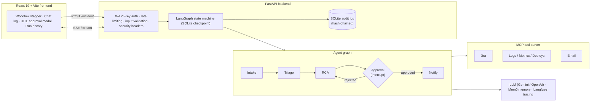

<h1 align="center">Incident Response Agent</h1>

<p align="center">
  <strong>An AI multi-agent system that automates incident triage, root cause analysis, and on-call notification — with a mandatory human-in-the-loop approval gate before anything is sent.</strong>
</p>

<p align="center">
  Built with LangGraph, MCP, Mem0, Langfuse, FastAPI, and React 19.
</p>

<p align="center">
  <a href="#"></a>
  <a href="#"></a>
  <a href="#"></a>
  <a href="#"></a>
  <a href="#"></a>
  <a href="./LICENSE"></a>
</p>

---

> **Why this project?** Real on-call work is mostly the same loop: pull logs, correlate
> with recent deploys, write the RCA, page the team. This system runs that loop with a
> graph of cooperating LLM agents, keeps a full audit trail of every decision, and — critically —
> **never notifies anyone without explicit human approval.** It is designed for a SOC/SRE
> context where automation must be auditable and safe.

## What It Does

When an incident fires, an SRE typically has to manually:
- Pull logs and metrics
- Figure out what changed (deployments, config)
- Write up a root cause analysis
- Notify the on-call team

This agent does all of that automatically — and pauses for human approval before sending any notifications.

**Alert fires → Agent investigates → Human approves → Team notified**

---

## The 5-Agent Workflow

```
Intake → Triage → RCA → Approval (HITL pause) → Notify
```

| Agent | What it does |
|-------|-------------|
| **Intake** | Fetches incident details from Jira (title, description, reporter, priority) |
| **Triage** | Assigns severity (P1–P4), identifies affected systems, queries Mem0 for similar past incidents |
| **RCA** | Queries logs, metrics, and deployment history — LLM identifies root cause and recommends a fix |
| **Approval** | Human-in-the-loop interrupt — workflow pauses until an authorized approver accepts or rejects |
| **Notify** | Sends email notification with full RCA summary to the on-call team |

---

## Architecture



The graph **interrupts before the `approval` node**. Checkpoints are written to SQLite on
disk (`backend/data/checkpoints.db`, next to the audit DB), so a run parked at the gate
survives an API restart: the process can be killed and redeployed and the pending approval
is still there to resume. Resuming continues the paused run rather than starting a new one,
so the triage and RCA produced before the pause are the ones the approver signed off on.

`resume_after_approval()` refuses to resume a thread that is not actually sitting at the
gate, so an unknown or already-resolved `run_id` cannot be used to fire a notification.

Every audit write is also **hash-chained**. Each entry in `audit_chain` carries a digest over
a snapshot of the run row plus the previous entry's digest, so editing a row, deleting one, or
renumbering history breaks the chain from that point on and verification names the first entry
that does not hold up. What that does and does not establish is spelled out under
[Security](#security) — it is tamper *evidence*, not immutability.

---

## Screenshots

> _Placeholder — add UI captures here._
>
> | Workflow stepper | HITL approval modal | Run history / audit log |
> |---|---|---|
> | `docs/screenshots/stepper.png` | `docs/screenshots/approval.png` | `docs/screenshots/history.png` |

---

## Tech Stack

| Layer | Technology |
|-------|-----------|
| **Orchestration** | [LangGraph](https://langchain-ai.github.io/langgraph/) — stateful multi-agent workflow with on-disk SQLite checkpointing, so HITL pauses survive a process restart |
| **LLM** | Google Gemini 2.5 Flash via `langchain-google-genai` (swap to OpenAI via `LLM_PROVIDER=openai`) |
| **Tools** | [MCP](https://modelcontextprotocol.io/) — modular tool server (Jira, logs, metrics, email) |
| **Memory** | [Mem0](https://mem0.ai/) — remembers past incidents and resolutions across runs |
| **Observability** | [Langfuse](https://langfuse.com/) — full LLM tracing, token usage, latency per agent |
| **Streaming** | [AG-UI](https://github.com/ag-ui-protocol/ag-ui) — SSE protocol for real-time frontend updates |
| **Backend** | FastAPI + uvicorn |
| **Frontend** | React 19 + TypeScript + Vite |
| **Audit log** | SQLite — persists every run with agent outputs, approval decision, and timestamps; each write is hash-chained so an edited or deleted row can be detected |
| **Rate limiting** | slowapi — 10 req/min on POST /incident, 20 req/min on POST /approve |

---

## Demo Incidents

| ID | Service | Issue | Severity |
|----|---------|-------|----------|
| `INC-101` | Auth service | Redis connection pool reduced by deployment → 97% cache miss rate → OOMKill | P1 |
| `INC-205` | Payment service | ORM migration didn't port connection pool config → PostgreSQL connection exhaustion | P2 |
| `INC-312` | Notification service | Marketing deploy accidentally applied unsubscribe logic to transactional emails → AWS SES suspended | P2 |

> Jira tickets, logs, and incident data are mocked for demo purposes. Integration layer is built and ready for real credentials.

---

## Project Structure

```
incident-response-agent/
├── backend/
│   ├── agents/
│   │   ├── intake_agent.py       # Fetches incident from Jira
│   │   ├── triage_agent.py       # Assigns severity and affected systems
│   │   ├── rca_agent.py          # Root cause analysis via logs + LLM
│   │   ├── notify_agent.py       # Sends email notification
│   │   └── llm_factory.py        # Gemini / OpenAI provider switch
│   ├── api/
│   │   └── main.py               # FastAPI routes + SSE streaming + rate limiting
│   ├── audit/
│   │   ├── log.py                # SQLite audit log — persists every run
│   │   ├── chain.py              # Hash chain over the audit rows + verification
│   │   └── verify.py             # `python -m backend.audit.verify` CLI
│   ├── data/                     # Runtime SQLite DBs — audit.db + checkpoints.db (gitignored)
│   ├── graph/
│   │   ├── workflow.py           # LangGraph graph definition + durable checkpointer
│   │   ├── nodes.py              # Node wrappers + routing logic
│   │   └── state.py              # IncidentState schema
│   ├── mcp_server/
│   │   └── tools/
│   │       ├── jira_tools.py     # Jira integration (mock → real via API token)
│   │       ├── log_tools.py      # Log/metrics/deployment data (mock → Splunk/Loki)
│   │       └── email_tools.py    # Email sending (mock → SMTP/SendGrid)
│   ├── memory/
│   │   └── mem0_client.py        # Mem0 for cross-run incident memory
│   ├── observability/
│   │   └── langfuse_client.py    # Langfuse tracing
│   ├── security/
│   │   └── untrusted.py          # Wraps reporter-written text before it reaches a model
│   ├── config.py                 # Env var loading
│   └── requirements.txt
├── frontend/
│   └── src/
│       ├── components/
│       │   ├── ChatUI.tsx             # Real-time chat event log
│       │   ├── WorkflowStepper.tsx    # Visual 5-step progress indicator
│       │   ├── IncidentDetails.tsx    # Live state panel
│       │   ├── HITLApprovalModal.tsx  # Human review modal
│       │   └── RunHistory.tsx         # Audit log table with search/filter
│       ├── hooks/
│       │   └── useAgentStream.ts      # SSE event consumer
│       └── api/
│           └── client.ts             # Axios API client
├── tests/                        # 303 tests, 93% coverage, no network/creds needed
│   ├── conftest.py               # Shared FakeLLM fixture + mocks
│   ├── test_agents.py            # Agent helper functions
│   ├── test_agent_pipeline.py    # Full agent run_* functions with mocked LLM
│   ├── test_api.py               # Input validators + safe-state allowlist
│   ├── test_approval_identity.py # The recorded approver comes from the credential
│   ├── test_api_endpoints.py     # HTTP-level auth / validation / response shape
│   ├── test_audit_chain.py       # Tamper evidence — detection, canonicalisation, limits
│   ├── test_audit_log.py         # SQLite audit log store
│   ├── test_checkpointer.py      # Checkpoint durability across a restart + approval gate
│   ├── test_clients.py           # Mem0 / Langfuse graceful degradation
│   ├── test_config.py            # Startup config validation
│   ├── test_graph.py             # Graph routing + node wiring
│   ├── test_mcp_server.py        # MCP tool registrations
│   ├── test_principals.py        # API key → principal parsing and resolution
│   ├── test_tools.py             # Enrichment tools (logs/metrics/jira/email)
│   └── test_untrusted.py         # Untrusted-input boundary (injection shapes, caps)
├── .github/
│   ├── workflows/
│   │   ├── ci.yml                # Lint (ruff) + type-check (mypy) + pytest + frontend build
│   │   ├── security.yml          # bandit + pip-audit + gitleaks + Trivy image scan
│   │   └── codeql.yml            # CodeQL (python + js/ts), security-extended
│   └── dependabot.yml            # Weekly pip / npm / docker / actions updates
├── backend/Dockerfile            # Non-root, healthcheck'd backend image
├── docker-compose.yml            # Local Langfuse + Postgres observability stack
├── pyproject.toml                # ruff / pytest / coverage / mypy config
├── start.sh                      # macOS one-click startup
├── start.ps1                     # Windows one-click startup
└── .env                          # Secrets — never committed
```

---

## Running Locally

### Prerequisites
- Python 3.11+
- Node.js 18+
- A `.env` file in the project root (see below)

### Quick start (macOS)
```bash
./start.sh
```
Opens both servers in separate Terminal windows automatically.

### Quick start (Windows)
```powershell
.\start.ps1
```

### Manual start

**Backend** (run from project root):
```bash
python -m venv .venv
source .venv/bin/activate      # Windows: .venv\Scripts\Activate.ps1
pip install -r backend/requirements.txt
uvicorn backend.api.main:api --reload --port 8000
```

**Frontend:**
```bash
cd frontend
npm install
npm run dev
```

Open **http://localhost:5173** (or 5174 if 5173 is in use).

### Running Tests
```bash
source .venv/bin/activate
pip install -r backend/requirements.txt -r backend/requirements-dev.txt
pytest tests --cov=backend --cov-report=term-missing
```
**303 tests, 93% coverage** — no network, LLM keys, or external services required. The LLM and
all external calls (Mem0, Jira, SMTP) are mocked via fixtures in `tests/conftest.py`.

### Verifying the Audit Log
```bash
python -m backend.audit.verify                      # the live backend/data/audit.db
python -m backend.audit.verify --db /tmp/copy.db     # a copy, with the API stopped
```
Exit status is `0` verified, `1` tampering found, `2` the log could not be read — the last
one matters for a cron job, because "could not open it" must not be reported as "clean".

### Lint & Security Scans (run what CI runs)
```bash
ruff check backend tests          # lint
mypy backend                      # type-check
bandit -r backend -ll             # static security analysis
pip-audit -r backend/requirements.txt   # dependency CVE audit
```

### Docker
```bash
docker build -f backend/Dockerfile -t ir-agent-backend .
docker run -p 8000:8000 --env-file .env ir-agent-backend
```

---

## Environment Variables (`.env` in project root)

```env
# LLM — required
GEMINI_API_KEY=your_gemini_key

# LLM provider — "gemini" (default) or "openai"
LLM_PROVIDER=gemini
OPENAI_API_KEY=                    # required if LLM_PROVIDER=openai

# API auth — named keys: principal:scopes:key, comma- or newline-separated.
# Scopes are submit, approve, or submit+approve. The approver recorded in the
# audit log is derived from the key, so approving needs the approve scope.
API_KEYS=alice@yourorg.com:submit+approve:long_random_key

# Legacy single shared key. Still authenticates and may submit, but it names
# nobody, so it cannot approve. Both blank = dev mode (no key required).
API_KEY=

# Jira (optional — mocked if not set)
JIRA_URL=https://yourorg.atlassian.net
JIRA_EMAIL=you@yourorg.com
JIRA_TOKEN=your_jira_api_token

# Email / SMTP (optional — mocked if not set)
SMTP_HOST=smtp.gmail.com
SMTP_PORT=587
SMTP_USER=you@gmail.com
SMTP_PASSWORD=your_app_password

# Observability (optional — graceful fallback if not set)
MEM0_API_KEY=your_mem0_key
LANGFUSE_PUBLIC_KEY=your_public_key
LANGFUSE_SECRET_KEY=your_secret_key
LANGFUSE_HOST=http://localhost:3001   # local Docker instance
```

---

## API Endpoints

| Method | Path | Auth | Description |
|--------|------|------|-------------|
| `POST` | `/incident` | API key (`submit`) | Start a new incident workflow |
| `GET` | `/stream/{run_id}` | — | SSE stream of AG-UI events |
| `POST` | `/approve/{run_id}` | API key (`approve`) | Submit approval / rejection — the approver is derived from the key |
| `GET` | `/runs` | API key | List all past runs (audit log) |
| `GET` | `/runs/{run_id}` | API key | Full detail for a single run |
| `GET` | `/incidents/search` | API key | Semantic search over Mem0 memory |
| `GET` | `/audit/verify` | API key | Verify the audit log's hash chain (see the caveat below) |
| `GET` | `/health` | — | Health check |

---

## Swapping Mocks for Real Integrations

Everything is built with a clear swap point — the agent logic doesn't change, only the data source.

| Mock | Real integration | What to change |
|------|-----------------|----------------|
| Jira mock | Jira REST API | Set `JIRA_URL`, `JIRA_EMAIL`, `JIRA_TOKEN` in `.env` |
| Log mock | Splunk / Loki / Datadog | Replace `query_system_logs()` in `log_tools.py` |
| Email mock | Gmail / SendGrid / SES | Set `SMTP_*` vars in `.env` |
| SQLite checkpointer | PostgreSQL | Swap `SqliteSaver` for `PostgresSaver` in `get_checkpointer()` (`workflow.py`) |

---

## Security

- **Auth** — POST endpoints and audit log protected by `X-API-Key` header; `API_KEYS` maps keys to named principals with `submit` / `approve` scopes; both key variables blank enables dev mode
- **Approver bound to the credential** — `POST /approve` records the principal that the presented key maps to, not a name from the request body. A body `approver` that disagrees with the credential is refused rather than overridden, a key with only `submit` cannot approve, and the legacy unnamed `API_KEY` cannot approve at all. Key material never reaches a log line or a response
- **Rate limiting** — 10 req/min on `POST /incident`, 20 req/min on `POST /approve`
- **Input validation** — incident ID format enforced (`INC-NNNN`), approval notes sanitized against prompt injection (control chars stripped, max length enforced); configured principal names are held to the audit column's charset so a config typo cannot put a newline in the log
- **Untrusted-input boundary** — every reporter-written field (title, description, reporter, and recalled Mem0 entries) is wrapped by `backend/security/untrusted.py` before it reaches a model: delimited with a per-call marker the content cannot close, instruction-override phrases / role turns / fence markers labelled in place, invisible and bidi characters removed, and a 4,000-char cap per field. Each agent's system prompt states the data/instruction split. What the guard changed is written to the run's audit row
- **Tamper-evident audit log** — every audit write appends an entry to `audit_chain`: a canonical snapshot of the run row, hashed together with its sequence number and the previous entry's digest. `GET /audit/verify` or `python -m backend.audit.verify` walks the chain and names the first entry that breaks, and also compares each live `runs` row against the snapshot the chain recorded for it — so an UPDATE that never touched `audit_chain` is caught too
- **State allowlist** — internal fields (`notification_recipients`, `messages`, `similar_incidents`) are never sent to the browser
- **Memory injection cap** — Mem0 context truncated to 500 chars per entry to prevent RAG data poisoning
- **Security headers** — `X-Content-Type-Options`, `X-Frame-Options`, `Referrer-Policy` on every response
- **Langfuse TLS** — warns if `LANGFUSE_HOST` points to a remote host over plain HTTP
- **Startup validation** — `validate_config()` fails fast on a missing LLM key or a malformed `API_KEYS` entry (naming the entry's position, never its contents), and loudly warns when auth is disabled or when no key can approve
- **No committed secrets** — all credentials come from environment variables; see [`SECURITY.md`](./SECURITY.md)

**On the input boundary, plainly:** wrapping raises the cost of prompt injection, it does not
eliminate it. The patterns in `untrusted.py` are a short list of known shapes, not a classifier,
and a model can still be steered by text that matches none of them. The structural defence here is
the human-approval interrupt — nothing is sent until a person accepts it. The guard's job is
narrower: keep the material that person reads from being quietly steered, and record it in the
audit trail when incoming content had to be changed, so an approver can tell that what they read
was sanitised. Nothing is silently discarded for the same reason — a control that drops the
evidence hides the attack from the only reviewer who could catch it.

**On who approved, plainly:** a static API key mapped to a name is *attribution to whoever
holds that key*, not authentication of a human being. A leaked or shared key is an impersonation,
and every control here — the scope check, the audit row, the hash chain — will faithfully attest
to it. What binding the identity to the credential does buy is narrower and worth stating exactly:
the name in the log is chosen by whoever configured the deployment rather than by the caller, a
key can be scoped so a webhook that files incidents cannot authorise a page, and a key can be
revoked. Real per-human identity needs SSO/OIDC with per-user tokens issued to people rather than
to processes — that is the next step, not something this change delivers.

Three cases needed deciding. A key that matches nothing is refused. The legacy single `API_KEY`
still authenticates and may still submit, but it names nobody, so `POST /approve` refuses it
rather than recording an approval with no identity attached — **an existing deployment that sets
only `API_KEY` must configure `API_KEYS` before anyone can approve again**, and startup warns
about exactly that. Dev mode (neither variable set) is the one case that is not a refusal: it is
the documented local mode, refusing there would break the demo, so the approval is recorded
against the principal `dev-mode-unauthenticated`, which says in the log what it is. In none of the
three can the caller choose the name.

**On the audit chain, plainly:** a local hash chain detects tampering by someone who edited the
file and did not recompute the chain — a stray `UPDATE`, a bug in this application, a careless
hand. It does **not** make the log immutable. Someone who can write to `audit.db` and redo every
digest from the genesis entry leaves nothing for the verifier to find, because the chain is
anchored to nothing outside the file. It also cannot notice entries removed from the *end*:
dropping the most recent entries along with their rows leaves a shorter chain that is internally
consistent, and nothing stored locally says how long the log was supposed to be. Closing either
gap needs something this process does not have — an append-only store, an external witness, or a
signing key the application cannot reach. Both limits are asserted by tests in
`tests/test_audit_chain.py` so this paragraph cannot quietly stop being true.

For the same reason `GET /audit/verify` is the convenient check and not the authoritative one: it
is answered by the process that writes the log. The check worth trusting is the CLI, run against
a copy of the file by someone who is not the application.

Rows already present in a deployed `audit.db` predate the chain. On the first start after this
change they are **adopted** — one `run_adopted` entry each, pinning what each row said at
migration time. The chain can show that an adopted row has not changed *since* adoption; it
cannot say anything about what that row said before, and the entry kind records which rows are
in that position rather than letting them pass as fully chained.

Boundaries that are **not** guarded yet, named rather than left implied:

| Gap | Why it is still open |
|-----|----------------------|
| Log, metric and deployment output in the RCA prompt | Currently mocked in `log_tools.py`. Real Splunk/Loki lines carry attacker-influenced strings (paths, user agents) and will need the same wrapper when those integrations land |
| Email subject line | `notify_agent` builds it from the raw title, bypassing the LLM. Harmless against the mock logger; a real SMTP client needs newlines stripped first |
| Approval modal | The findings are on the API response and the audit row, but the React modal does not render them yet, so today an approver has to read `GET /runs/{run_id}` to see them |
| `GET /stream/{run_id}` | Unauthenticated by design so the browser can follow a run without holding a key. Its state snapshot includes the run's `approver`, which is now a configured principal name — anyone who can reach the API and guess a `run_id` can read it |

For vulnerability reporting and the full security posture, see [`SECURITY.md`](./SECURITY.md).

---

## Engineering Practices

| Area | Tooling |
|------|---------|
| **CI** | GitHub Actions — ruff lint, mypy type-check, pytest (Python 3.11 & 3.12 matrix), frontend build |
| **Coverage gate** | `--cov-fail-under=80` enforced in CI |
| **SAST** | Bandit on every push/PR |
| **Dependency audit** | pip-audit (weekly + on PR) |
| **Secret scanning** | gitleaks on full history |
| **Container scanning** | Trivy on the built backend image + filesystem (SARIF → GitHub Security tab) |
| **Code scanning** | CodeQL (`security-extended`) for Python and TypeScript |
| **Dependency updates** | Dependabot — pip, npm, Docker, GitHub Actions |
| **Reproducibility** | Fully pinned `requirements.txt` |

---

## Roadmap

- [ ] PagerDuty / Prometheus webhook trigger (zero-touch incident creation)
- [ ] Slack / Teams notification channel
- [ ] SSO / OIDC with per-user tokens, so the audit log records a person rather than a key holder
- [ ] Reject flow re-runs RCA with approver feedback
- [ ] Real Jira, email, and log integrations (credentials pending)
- [ ] Surface input-guard findings in the approval modal, not just `GET /runs/{run_id}`
- [ ] Extend the untrusted-input wrapper to real log/metric tool output
- [ ] Anchor the audit chain outside the host (periodic signed head, or an append-only store) so a full-database rewrite is detectable

---

## Contributing

Contributions are welcome — see [`CONTRIBUTING.md`](./CONTRIBUTING.md) for the dev setup,
coding standards, and the checks your PR must pass.

## License

Released under the [MIT License](./LICENSE).

## Author

**Basit Sherazi** — Cybersecurity & AI Engineering
